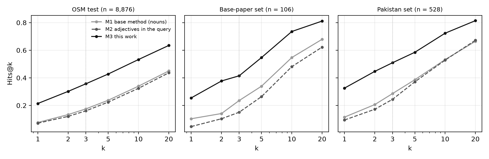
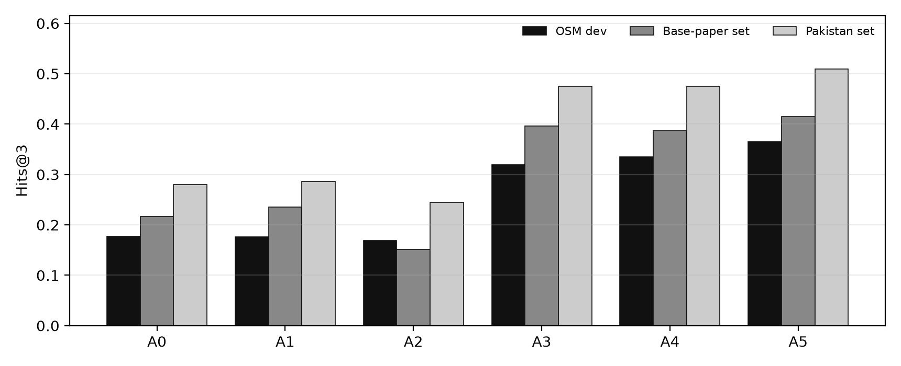
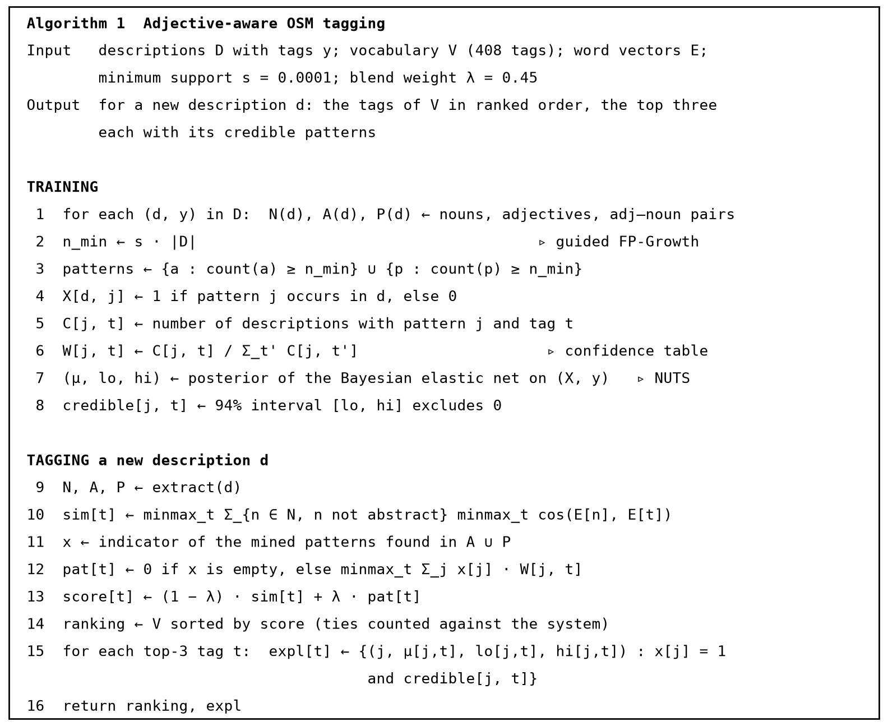
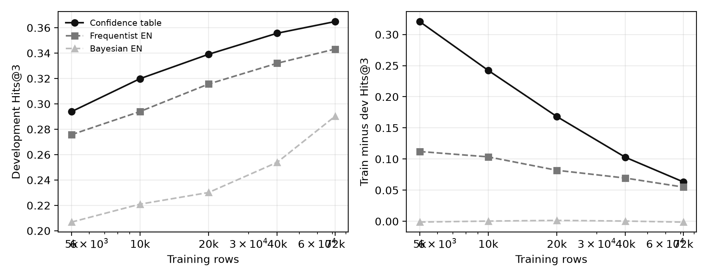
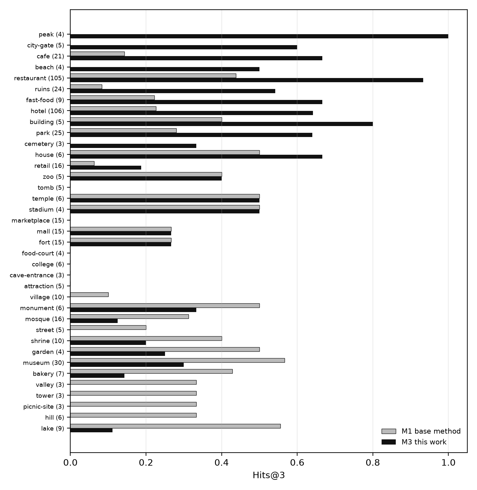
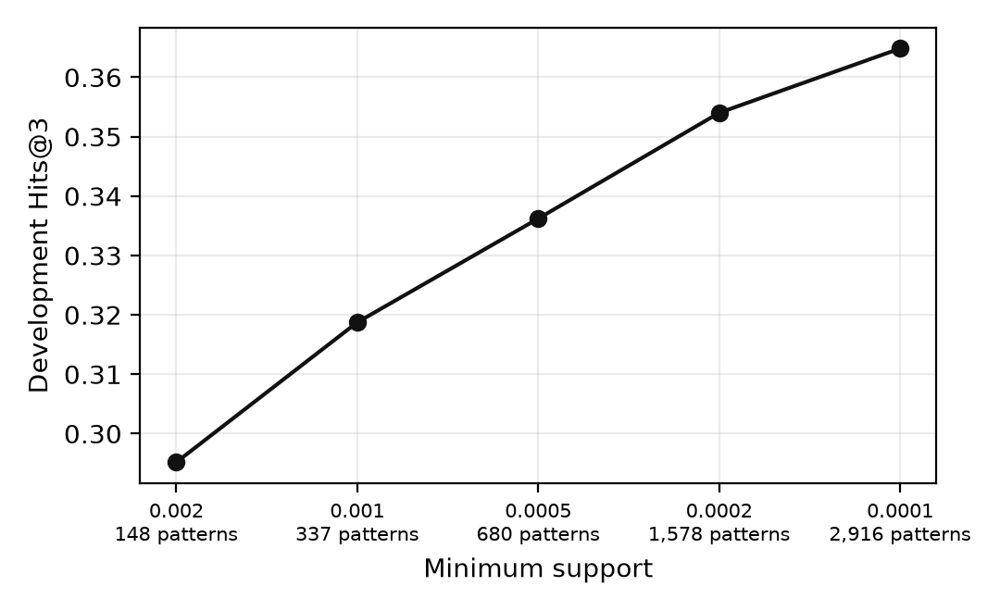
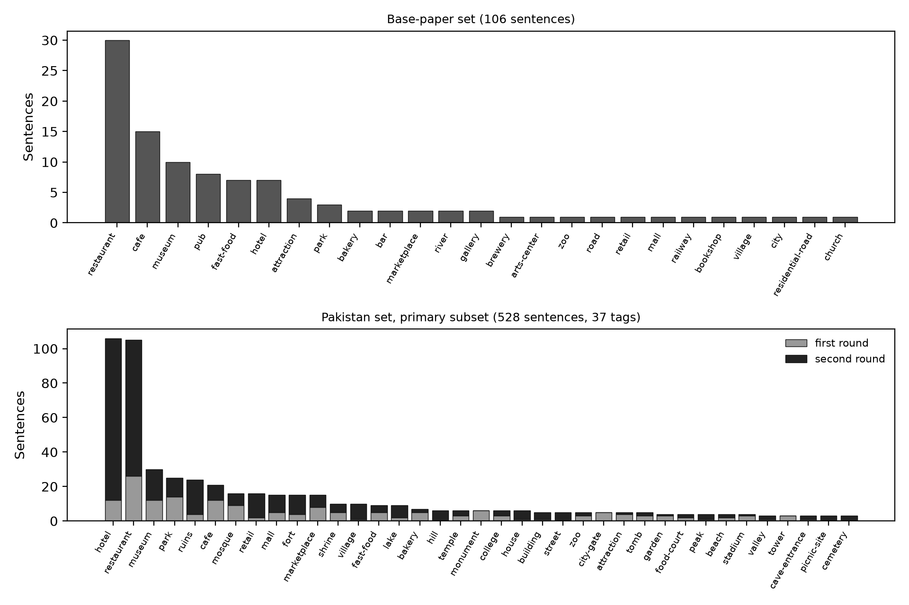

# Adjective-aware OpenStreetMap tagging of place descriptions

Code, data and results for the MS thesis *Geospatial Tagging of Volunteered Place Descriptions:
Bayesian Elastic Net and Extended FP-Growth Approach* (Faizan Shah Ahmad, Air University, Islamabad, 2026).

Given a short description of a place written by a person ("a quiet Mughal-era courtyard with a
marble prayer hall"), the system ranks 408 OpenStreetMap place tags so that the right tag (`mosque`) is
near the top. The base method of Yousaf et al. (2023) uses only the nouns of the description. This work
adds the adjectives: it mines adjective and adjective-noun patterns that co-occur with tags, weights them,
and blends the pattern scores with noun similarity. The 408-tag vocabulary is built from the map data,
because the base method's list of 227 tags has no entry for everyday places such as clothes shops.

## Try it

The thesis model is also a small web page, the **place tagger**: https://bat.tail3da3d0.ts.net

Type a description that does not name the place ("a quiet spot in F-7 with good cold coffee") and it ranks all 408 tags, shows
the adjectives behind each one and how sure the model is. Access is by invitation code, and the page has a form to request one.
It runs on the author's laptop, so it can serve only a few people at once and is offline whenever the laptop is. The receipt on the
[results page](docs/index.html) runs the same ranking on fixed examples and always works.

## Results page

A static page with the interactive ranking receipt, the charts and the limits is in `docs/` (`docs/index.html`, built from the
result files by `tools/build_site.py`). To publish it: Settings, Pages, deploy from the `main` branch, folder `/docs`. For a
subdomain, put the host name in a file `docs/CNAME` and add a CNAME record for it at your DNS provider pointing to
`phaze7r.github.io`. After the result files change, run `python tools/build_site.py` and `python tools/build_readme.py`.

## Results

Three methods on the same vocabulary and splits (the final evaluation, `thesisv2/`). M1 is the base method,
M2 adds the adjectives to the similarity query without mining, M3 is this work.

| Evaluation | Rows | M1 | M2 | M3 | M3 − M1 |
|---|---|---|---|---|---|
| OpenStreetMap test set, sealed until the protocol was frozen, scored once | 8,876 | 0.175 | 0.161 | **0.357** | Holm p < 0.0001 |
| Base-paper evaluation set (Yousaf et al., 2023) | 106 | 0.236 | 0.151 | **0.415** | Holm p = 0.007 |
| Pakistan evaluation set, primary subset, automatic nouns (post hoc) | 528 | 0.286 | 0.244 | **0.509** | Holm p < 0.0001 |

Hits@3 is the share of descriptions whose correct tag is among the three top-ranked tags. The protocol was
frozen before the test split was opened; the Pakistan set was completed after an earlier run, so its
result is post hoc. Details, ablations and limitations are in the thesis.



Other findings:

- Guided FP-Growth returns the same pattern-tag itemsets as extended FP-Growth at every corpus size tested,
  up to the full 71,784 transactions, 746 times faster (3.2 s against 2,403 s; minimum support 0.0005).
- The mined adjective patterns carry the gain (+0.150 Hits@3 on the development set, +0.231 on the
  Pakistan set); adding adjectives directly to the similarity query lowers accuracy on every set.
- The Bayesian elastic net (NumPyro, NUTS, scale-mixture prior) gives every pattern weight a 94% credible
  interval, so a prediction can be explained by the model's own coefficients. Used as the ranker it costs
  0.075 Hits@3 on the test set, so the ranker is the unselected confidence table and the Bayesian model
  supplies the explanations; a credible contributing pattern exists for 32 to 53% of top-ranked tags.



A0 base method · A1 abstract nouns removed · A2 adjectives pasted into the query · A3 mined adjective table ·
A4 plus adjective-noun pairs · A5 Numberbatch embeddings (final). The jump at A3 is the contribution.

### How it works



The confidence table (line 6) ranks; the Bayesian elastic net (lines 7 and 8) supplies the credible
intervals that explain a prediction (line 15). The learning curves below show the table still improving
with more training text:



<!-- results:start (written by tools/build_readme.py; edit the script, not this block) -->
## All results

Every number below is read from `thesisv2/results/` and `thesisv2/report/tables/`. Hits@3 is the headline metric; the thesis
gives the full tables and the statistics.

### All metrics, three methods

| Set | n | Method | Hits@1 | Hits@3 | Hits@5 | nDCG@20 |
| --- | --- | --- | ---: | ---: | ---: | ---: |
| OSM test | 8,876 | M1 base method (nouns) | 0.077 | 0.175 | 0.238 | 0.220 |
| OSM test | 8,876 | M2 adjectives in the query | 0.072 | 0.161 | 0.224 | 0.209 |
| OSM test | 8,876 | M3 this work | 0.214 | 0.357 | 0.428 | 0.386 |
| Base-paper set | 106 | M1 base method (nouns) | 0.104 | 0.236 | 0.340 | 0.318 |
| Base-paper set | 106 | M2 adjectives in the query | 0.047 | 0.151 | 0.264 | 0.259 |
| Base-paper set | 106 | M3 this work | 0.255 | 0.415 | 0.547 | 0.487 |
| Pakistan set | 528 | M1 base method (nouns) | 0.116 | 0.286 | 0.386 | 0.336 |
| Pakistan set | 528 | M2 adjectives in the query | 0.095 | 0.244 | 0.371 | 0.319 |
| Pakistan set | 528 | M3 this work | 0.326 | 0.509 | 0.585 | 0.532 |

### Where the gain comes from (Hits@3, cumulative steps)

| Step | OSM dev | Base-paper set | Pakistan set |
| --- | ---: | ---: | ---: |
| A0 Base method, abstract nouns kept | 0.178 | 0.217 | 0.280 |
| A1 + abstract-noun removal | 0.176 | 0.236 | 0.286 |
| A2 + adjectives added to the query (control) | 0.169 | 0.151 | 0.244 |
| A3 abstract removal + adjective-pattern table | 0.319 | 0.396 | 0.475 |
| A4 + adjective-noun pair patterns | 0.335 | 0.387 | 0.475 |
| A5 with Numberbatch (final configuration) | 0.365 | 0.415 | 0.509 |

A2 is the control: the adjectives are pasted into the similarity query and nothing is mined. The jump at A3 is the contribution.

### Per tag on the Pakistan set



The pooled gain is not a gain for every tag: M3 is ahead on 13 of 37 tags, behind on 13 and level on 11. It loses on tags with no
training text (shrine, lake, hill) and where the nouns already said it.

### Guided against extended FP-Growth

Pattern-to-tag itemsets at minimum support 0.0005 (the pipeline itself uses 0.0001, where extended FP-Growth does not finish):

| Transactions | Guided | Extended | Identical |
|---:|---:|---:|---|
| 5,000 | 378 | 378 | yes |
| 10,000 | 359 | 359 | yes |
| 20,000 | 307 | 307 | yes |
| 40,000 | 253 | 253 | yes |
| 71,784 | 242 | 242 | yes |

On the full 71,784 transactions guided mining took 3.22 s, extended FP-Growth 2,403 s and 1,835 MB: 746 times slower. (Timings of the two smallest extended runs were inflated by a duplicate job and are not quoted.)

### The Bayesian elastic net

| Quantity | Value |
| --- | ---: |
| Training rows with at least one pattern | 46,443 |
| Patterns × tags | 2,916 × 384 |
| Chains, warm-up, retained draws per chain | 2, 1,000, 1,000 |
| Fit time | 8,803 s |
| Divergent transitions | 0 |
| R̂ over the 200 strongest patterns, median / maximum | 1.000 / 1.006 |
| Effective sample size, median | 2,838 |
| Credible coefficients (94% interval excludes zero) | 0.04% |
| Patterns with at least one credible tag | 286 of 2,916 |
| Median interval width | 1.17 |

As the ranker it costs 0.075 Hits@3 on the test set, so it supplies the explanations while the confidence table ranks.

| Set | n | Gold-tag credible pattern | Top-ranked tag has a credible pattern |
|---|---:|---:|---:|
| OSM development set | 9,042 | 16.6% | 32.0% |
| Base-paper sentences | 106 | 20.8% | 44.3% |
| Pakistan set | 528 | 28.6% | 52.8% |

### Minimum support

| Minimum support | Patterns (adjectives + pairs) | Dev Hits@3 | Δ against 0.0001 | 95% CI |
| --- | ---: | ---: | ---: | ---: |
| 0.002 | 148 (140 + 8) | 0.295 | -0.070 | [-0.077, -0.063] |
| 0.001 | 337 (293 + 44) | 0.319 | -0.046 | [-0.052, -0.040] |
| 0.0005 | 680 (517 + 163) | 0.336 | -0.029 | [-0.034, -0.023] |
| 0.0002 | 1,578 (941 + 637) | 0.354 | -0.011 | [-0.015, -0.007] |
| 0.0001 | 2,916 (1,393 + 1,523) | 0.365 | n/a (used) |  |



### Urdu and Roman Urdu, through translation

| Input | Method | n | English original | After translation | Change |
| --- | --- | ---: | ---: | ---: | ---: |
| Urdu (author-written), 157 rows | M1 base method (nouns) | 157 | 0.331 | 0.287 | -0.045 |
| Urdu (author-written), 157 rows | M3 this work | 157 | 0.490 | 0.471 | -0.019 |
| Roman Urdu, 300 rows | M1 base method (nouns) | 300 | 0.287 | 0.283 | -0.003 |
| Roman Urdu, 300 rows | M3 this work | 300 | 0.473 | 0.443 | -0.030 |
| Roman Urdu written by the author, 60 rows | M1 base method (nouns) | 60 | 0.400 | 0.350 | -0.050 |
| Roman Urdu written by the author, 60 rows | M3 this work | 60 | 0.717 | 0.583 | -0.133 |
| Roman Urdu drafted from English and checked, 240 rows | M1 base method (nouns) | 240 | 0.258 | 0.267 | +0.008 |
| Roman Urdu drafted from English and checked, 240 rows | M3 this work | 240 | 0.412 | 0.408 | -0.004 |

### The earlier run on the base paper's 227 tags

| Set | Earlier n | Earlier base | Earlier pipeline | Earlier gain | Final n | Final base (M1) | Final pipeline (M3) | Final gain |
| --- | ---: | ---: | ---: | ---: | ---: | ---: | ---: | ---: |
| OSM test | 7,017 | 0.189 | 0.380 | +0.191 | 8,876 | 0.175 | 0.357 | +0.182 |
| Base-paper sentences | 106 | 0.434 | 0.547 | +0.113 | 106 | 0.236 | 0.415 | +0.179 |
| Pakistan set (528) | 528 | 0.381 | 0.545 | +0.165 | 528 | 0.286 | 0.509 | +0.223 |

### Data

| Step | Rows remaining |
| --- | ---: |
| OSM element-key rows in the harvest | 2,875,608 |
| Rows whose key and value map to a vocabulary tag | 1,540,161 |
| Elements with exactly one tag (75,983 ambiguous elements dropped) | 1,377,786 |
| Descriptions identified as English (py3langid, p ≥ 0.6) | 150,225 |
| At least four content words after masking the type words | 145,179 |
| After exact and template duplicates are removed | 92,961 |
| After the cap of 3,000 per tag and the floor of 10 rows per tag | 89,702 |

| Block | Tags |
| --- | ---: |
| Everyday places | 307 |
| Tourism and heritage places | 87 |
| Forced in because a gold tag of an evaluation set needs it | 14 |
| Total | 408 |


<!-- results:end -->

## Repository layout

```
thesisv2/    the final evaluation: step scripts s00 to s12, the 408-tag vocabulary, result files, report
notebooks/   thesisv2/: one notebook per final-evaluation step (outputs stripped)
src/         pipeline_ranker.py (ranking stage), adjective_extractor.py (spaCy extraction stage)
scripts/     pakistan_extension/: collection, checking and freezing of the extended Pakistan set
data/        tags_227.txt (the base paper's vocabulary), pakistan/ (the Pakistan evaluation set and its sources)
tools/       strip_notebooks.py (run before committing a notebook), make_public_dataset.py
docs/        figures used in this README
archive/     earlier work kept as a record, not part of the thesis: see archive/README.md
```

Start with `thesisv2/README.md` and `thesisv2/RUNBOOK.md`: each step is a script and a notebook, run in order on
Google Colab. The preliminary study, the earlier run on the 227 tags (thesis Section 6.6) and the first version of
this repository are in `archive/`, with a note on why the work moved to the final approach.

## Reproducing

The final evaluation is a chain of steps (`thesisv2/scripts/`, one notebook each in `notebooks/thesisv2/`) run in
order on Google Colab with Google Drive mounted; `thesisv2/RUNBOOK.md` gives the commands, the runtime each step
needs and what a pass looks like. Every step writes a manifest with input and output hashes, and the test step
first checks that every frozen setting reproduces its development figure exactly. Large intermediate files (the
cleaned corpus, embedding caches, fitted tables) are not in this repository; the steps regenerate them from the
public sources:

- OpenStreetMap through the QLever SPARQL endpoint of the OSM planet (ODbL 1.0)
- English Wikivoyage dump, snapshot 2026-07-01 (CC BY-SA 4.0), for the Pakistan set
- Word2Vec Google News vectors and ConceptNet Numberbatch 17.06, through `gensim.downloader`

Step 0 reads one input the final steps do not make: the raw harvest of every OpenStreetMap element that has a
description tag (`osmfinal/raw/osm_descriptions.parquet`, 2.9 million rows). It is made by cells R0a to R0e of
`archive/earlier_run_227/notebooks/11_final_preregistered_run_osm.ipynb`, which is the one archived notebook the
final run depends on. Run those cells first.

The base paper's 106-sentence evaluation set is not redistributed here; it is published by its authors
(Yousaf, Schwartz and Wolter, 2023). Each result file in `thesisv2/results/` records the protocol it followed.

## The Pakistan evaluation set

`data/pakistan/pk_extended.json` has 592 descriptions of Pakistani places over 84 tags; the primary
subset (`primary_subset: true`, tags with at least three descriptions) has 528. The first 199 come from
Wikivoyage, Reddit and OpenStreetMap; the other 393 are reworded Wikivoyage listings, each traceable to
its article, listing and revision (`source_url`, `source_revid`, `source_text`). Urdu versions exist for
157 rows and Roman-Urdu versions for 300 (`roman_origin` says how each was produced). The text of the 26
Reddit-derived rows is withheld; their post identifiers are kept so the rows can be rehydrated.

## Licence

- **Code** (notebooks, `src/`, `scripts/`, `tools/`): Apache License 2.0, see `LICENSE` and `NOTICE`.
- **Data** (`data/`): see `LICENSE-DATA.md`. Rows derived from Wikivoyage are CC BY-SA 4.0, rows derived
  from OpenStreetMap are ODbL 1.0; each row carries its own `license` field.

Contributions are welcome under the same terms; see `CONTRIBUTING.md`.

## Citing

If you use this code or data, please cite the thesis (see `CITATION.cff`) and the base paper:

Yousaf, M., Schwartz, T., & Wolter, D. (2023). Automated interpretation of place descriptions:
Determining entity types for querying OSM. *KI - Künstliche Intelligenz, 37*(1), 69 to 81.
https://doi.org/10.1007/s13218-022-00798-y

A web demonstrator of the pipeline is maintained separately.
